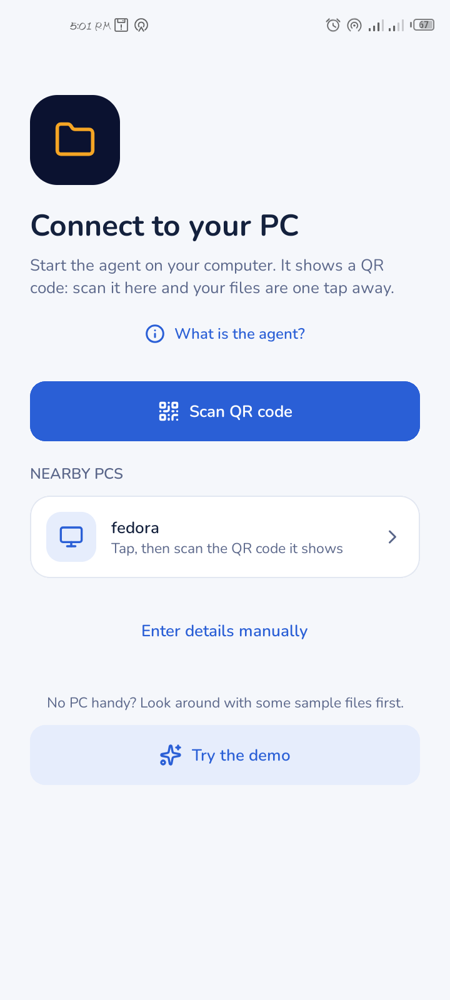
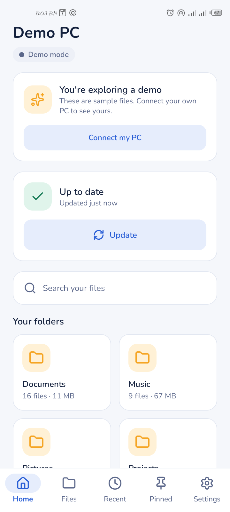
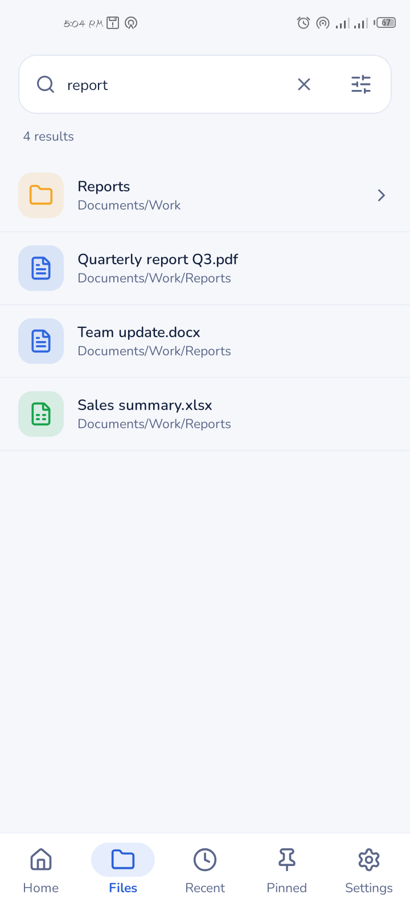
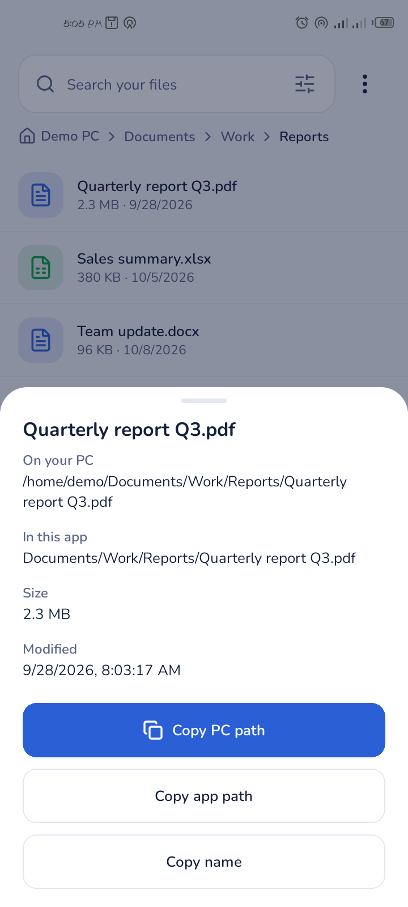
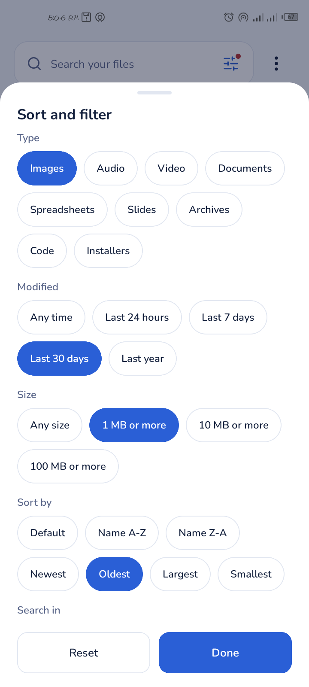
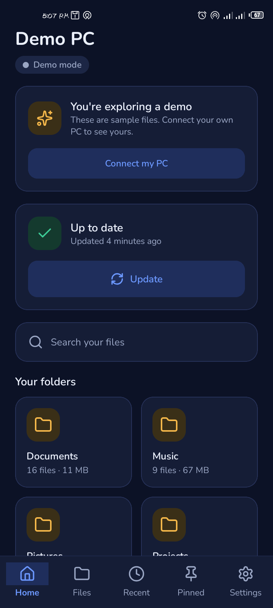

# FS Indexer

**Search and browse your computer's files from your phone, even when the computer is asleep.**

A small **agent** on your PC makes a list of the folders you choose. The **app** copies that list to your phone, so you can search it instantly, anywhere you are. Your files stay on your PC unless you decide to open or download them.

> **Working name.** The project is called FS Indexer until its final name is chosen.

## What it does

- **Find any file by name or folder** from your phone. Once synced, search works offline.
- **You choose what is shared.** Passwords, keys and `.env` files are always skipped, and hidden files are off by default.
- **Optional, and off by default:** open or download files from your PC to your phone, and send files from your phone into one drop folder on your PC.
- **Pair with a QR code.** Every phone gets its own key, and you can remove a phone at any time.
- **A friendly dashboard** on the PC for folders, phones, settings and troubleshooting.
- **Free and open source (MIT).** No accounts, no ads, no analytics. Nothing is sent to us or to the cloud.

## How it works

```text
   Your PC                                          Your phone
 ┌───────────────────┐    your own network     ┌─────────────────┐
 │  agent            │ ◄─────────────────────► │  app            │
 │  lists the folders│   the file list, and    │  search, browse │
 │  you choose       │   files only if allowed │  open, download │
 └───────────────────┘                         └─────────────────┘
```

The agent only talks to devices on your local network. The app keeps its own copy of the file list, so searching needs no connection.

## Important: trusted networks only

The connection between your phone and PC is **not encrypted yet**. Use it on a network you trust, such as your home Wi-Fi, or link just the two devices directly with a phone hotspot. Opening and sending files are off until you switch them on. See [the security model](docs/SECURITY_MODEL.md).

## Install

| | Download | Notes |
| --- | --- | --- |
| **Windows** | `fsagent_<version>_windows_amd64.zip` | Unzip and double-click `fsagent.exe`. Windows SmartScreen: "More info", then "Run anyway". Allow the firewall prompt on **Private** networks. |
| **macOS** | `FS-Indexer_<version>_macOS_arm64.app.zip` (Apple silicon) or `_amd64` (Intel) | Unzip, then right-click **FS Indexer**, then Open (it isn't signed yet). |
| **Linux** | `.deb`, `.rpm` or `.tar.gz` | `sudo dnf install ./fsagent_*.rpm` or `sudo apt install ./fsagent_*.deb`. FS Indexer then appears in your menu. |
| **Android** | `fs-browser-<version>.apk` | Install it from the release page (allow "install unknown apps" once). A Play Store listing is planned. |
| **iPhone** | Planned | |

Everything is on the [releases page](https://github.com/brandnova/FS-Indexer/releases). Check any download against `checksums.txt`. Use the app and the agent from the same release.

## Quick start

1. **Start the agent** on your PC. The first time, it opens its dashboard in your browser and shows a pairing code.
2. **Open the app** and tap **Scan QR code**, then point the camera at the code (or choose "Enter details manually" and type the address and code).
3. **Tap Update** in the app. Your files appear.

More: [Getting started](docs/GETTING_STARTED.md) · [FAQ](docs/FAQ.md).

## Screenshots

| | | |
| --- | --- | --- |
|  |  |  |
|  |  |  |

## Documentation

- [Getting started](docs/GETTING_STARTED.md): install, first run, uninstall
- [FAQ](docs/FAQ.md): common questions and fixes
- [Security model](docs/SECURITY_MODEL.md) and the [security policy](SECURITY.md)
- [Privacy policy](docs/PRIVACY.md)
- [API reference](docs/API.md): for developers
- [Roadmap](docs/FEATURES.md)
- [Third-party notices](THIRD_PARTY_NOTICES.md)

## Build from source

```bash
git clone https://github.com/brandnova/FS-Indexer.git
cd FS-Indexer

# The agent (Go)
cd agent && go test ./... && go build -o fsagent . && ./fsagent

# The app (Expo / React Native). It needs a development build, not Expo Go.
cd mobile && npm install && npx expo start
```

Repository layout: `agent/` (the Go agent and its dashboard), `mobile/` (the app), `docs/`, `scripts/` (release and packaging helpers), `packaging/` and `branding/`.

## Support and security

- **Questions and bugs:** [open an issue](https://github.com/brandnova/FS-Indexer/issues) or email **brandnova.dev@gmail.com**. In the dashboard, **Help -> Report a problem** collects what's needed, with your keys and user name removed. Nothing is sent automatically.
- **Security problems:** see [SECURITY.md](SECURITY.md). Please don't post them publicly.

## License and credits

MIT License (see [LICENSE](LICENSE)). Made by [Brand Nova](https://brandnova.pythonanywhere.com). The Brand Nova name and logo are not covered by the MIT licence. Open-source components are listed in [THIRD_PARTY_NOTICES.md](THIRD_PARTY_NOTICES.md).
